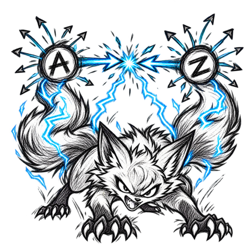

<p align="center">
  
</p>

<h1 align="center">TWOtails</h1>

<p align="center">
  <em>AI Code Quality Analyzer - 20 scanners, 12 languages, 1 truth, zero false positives</em>
</p>

<p align="center">
  
  
  
  
</p>

---

## What is TWOtails?

When AI writes your code, something small is always missing. A button with no
click handler. A function that is called but never written. A password hiding
in the code. A database table that was never created. A CI/CD workflow with
unpinned actions. A container with wrong health check. AI moves fast — and it
leaves these small holes behind.

**TWOtails is a unified evaluation platform for AI-written code.** It works as a skill
and CLI for **Antigravity, Cursor, Claude Code, Codex, GitHub Copilot,
OpenCode**, and any agent that reads `AGENTS.md`. You run one command, and it
reads your whole project and tells you exactly what is broken, what is missing,
and what is dangerous — with the file name, the line number, and a simple fix
suggestion.

### What it does

- **Reads every line** of your project with real code parsing (AST), not simple text matching
- **Checks both ends of every connection** — where a signal is sent, and where
  it should be received. That is the "two tails" method. If both ends match,
  the code is fine. If one end is missing, it reports a bug. Because both
  sides must match before anything is reported, you get **zero false alarms**
- **Runs 20 scanners** across 4 categories:
  - **Code Quality** (7): Connectivity, Database, API Routes, AI Quality, Security, Environment, Error Handling
  - **Dependencies & Infrastructure** (5): Dependencies, Docker, WebSocket, Test Coverage, Multi-Language
  - **CI/CD & Operations** (5): CI/CD Workflows, Functional Tests, Prompt Security, Tokens, Dependencies
  - **AI Evaluation** (3): Failure Scenarios, Agent Runner, Reliability Scoring
- **Understands 12 languages**: JavaScript, TypeScript, Python, Go, Java,
  Ruby, Rust, PHP, C#, Swift, Kotlin, Scala
- **Runs functional tests** in isolated Docker containers (build, test, lint)
- **Evaluates AI agents** on deterministic failure scenarios with ground truth
- **Produces transparent reliability scores** — componentized, not opaque
- **Never changes your code** — it only reports problems and shows suggestions

### How it helps AI agents and AI tools

AI agents write code fast, but they cannot always see the whole project at
once. They may call a function that does not exist, forget to connect a
button, or leave a secret in the code. TWOtails works like a **second pair of
eyes** for the agent:

1. The agent writes code
2. The agent (or you) runs `twotails scan ./src`
3. TWOtails returns a clear list: file, line, problem, and fix
4. The agent fixes only the real problems — no guessing, no wasted turns

**For DevOps failures**, TWOtails goes further — it runs the agent against
deterministic failure scenarios (wrong env var, port mismatch, OOM kill, bad
health check, etc.) and scores:
- **Diagnosis accuracy** — did the agent find the real root cause?
- **Reproduction success** — can the steps reliably reproduce the failure?
- **Verified recovery** — does the fix actually pass health checks?

This stops the agent from looping over the same bug again and again, saves you
from reading every line of AI code by hand, and keeps broken code out of
production. A full scan takes about **1 second for a 50-file project**, so an
agent can run it after every change and still stay fast.

### Who is it for?

- **Developers** who use AI copilots and want a fast safety check before they commit
- **AI agents and coding assistants** that need real feedback instead of guessing
- **Teams** that review a lot of AI-generated code every day
- **CI/CD pipelines** — `twotails scan` exits with error code 1 if broken code is found, so bad code never merges
- **Code reviewers** who want a pre-checked list of problems before they start reading
- **Platform engineers** evaluating AI agents for DevOps automation
- **Researchers** benchmarking AI agent reliability on DevOps tasks

## Profile

<p align="center">
  <b>Two signals, one truth.</b> Every connection is verified from both ends — sender and receiver must collide before it counts as connected.
</p>

<table align="center">
  <tr>
    <td align="center" width="25%"><b>AST Parsing</b><br>Acorn + JSX-aware walkers<br>JavaScript · TypeScript</td>
    <td align="center" width="25%"><b>Bidirectional Tracing</b><br>Sender + receiver signals<br>Zero false positives</td>
    <td align="center" width="25%"><b>20 Scanners</b><br>Code · CI/CD · AI Eval<br>Infra · Security · more</td>
    <td align="center" width="25%"><b>Virtual Memory</b><br>Real Playwright browsers<br>UI tests in sandboxes</td>
  </tr>
</table>

<p align="center">
  
  
  
  
  
  
  
</p>


## 12 Languages Supported

| Language | Extensions | Features |
|----------|------------|----------|
| **JavaScript** | `.js` | Full AST parsing, React support |
| **TypeScript** | `.ts`, `.tsx` | Type checking, interface analysis |
| **Python** | `.py` | AST analysis, import detection, docstrings |
| **Go** | `.go` | Goroutine analysis, error handling |
| **Java** | `.java` | Generic types, exception handling |
| **Ruby** | `.rb` | Rescue blocks, eval detection |
| **Rust** | `.rs` | Unsafe blocks, unwrap detection |
| **PHP** | `.php` | SQL injection, echo detection |
| **C#** | `.cs` | Null reference, debug statements |
| **Swift** | `.swift` | Force unwrap, optional binding |
| **Kotlin** | `.kt` | Non-null assertion, println detection |
| **Scala** | `.scala` | Option.get, pattern matching |

## 20 Scanners, 1 Command

```bash
twotails scan ./src        # Runs ALL 20 scanners across 12 languages
twotails languages ./src   # Multi-language scanner only (Python, Go, Java, etc.)
twotails paywall ./src     # Paywall connection verifier (RevenueCat, Stripe, Paddle)
twotails cicd ./src        # CI/CD workflow analysis (GitHub Actions)
twotails test-suite ./src  # Functional test harness (build/test/lint in Docker)
twotails evaluate ./src    # Full evaluation: static + CI/CD + tests + scenarios
```

| # | Scanner | Category | What It Finds |
|---|---------|----------|---------------|
| 1 | **Connectivity** | Code Quality | Undefined functions, missing handlers, unused imports, parameter mismatches |
| 2 | **Database** | Code Quality | Missing models, broken queries, missing awaits, unused models, broken relations |
| 3 | **API Routes** | Code Quality | Missing handlers, unvalidated inputs, missing auth, duplicate routes |
| 4 | **AI Quality** | Code Quality | Fake packages, deprecated patterns, empty catch blocks, debug statements |
| 5 | **Security** | Code Quality | Hardcoded secrets, SQL injection, XSS, command injection, weak crypto |
| 6 | **Environment** | Code Quality | Missing env vars, weak secrets, missing .env files, config issues |
| 7 | **Error Handling** | Code Quality | Empty catch blocks, missing error handlers, uncaught promises |
| 8 | **Prompts** | AI Safety | Prompt injection, jailbreak patterns, unsafe system prompts |
| 9 | **Tokens** | AI Safety | Token counting, LLM cost estimation, large file detection |
| 10 | **Dependencies** | Infra | Vulnerable packages, deprecated packages, outdated dependencies |
| 11 | **Docker** | Infra | Dockerfile security, missing .dockerignore, container best practices |
| 12 | **WebSocket** | Infra | Missing reconnection logic, no heartbeat, connection issues |
| 13 | **Test Coverage** | Infra | Untested functions, missing test files, coverage gaps |
| 14 | **Multi-Language** | Code Quality | Python, Go, Java, Ruby, Rust, PHP, C#, Swift, Kotlin, Scala issues |
| 15 | **CI/CD Workflows** | CI/CD Ops | GitHub Actions syntax, triggers, jobs, action pinning, permissions, secrets |
| 16 | **Functional Tests** | CI/CD Ops | Build/test/lint execution in isolated Docker containers |
| 17 | **Failure Scenarios** | AI Eval | 8 deterministic DevOps failures with ground truth (wrong env, port mismatch, OOM, etc.) |
| 18 | **Reliability Scorer** | AI Eval | Transparent weighted scoring for CI/CD and failure reproduction |
| 19 | **Agent Runner** | AI Eval | Bounded prompt/tool interface for AI agent evaluation |
| 20 | **Unified Evaluator** | AI Eval | Single pipeline: static + CI/CD + tests + scenarios + agent eval |

Plus a standalone **Paywall Connection** checker (`twotails paywall`) that verifies RevenueCat, Stripe, Paddle, App Store, and Play Store integrations are wired end to end.

## Quick Start

```bash
# Install
npm install -g @pavana/twotails

# Run full analysis
twotails scan ./src

# Run specific scanner
twotails security ./src
twotails database ./src
twotails api ./src
twotails ai-quality ./src
twotails env ./src
twotails connectivity ./src
twotails prompts ./src
twotails tokens ./src
twotails errors ./src
twotails dependencies ./src
twotails docker ./src
twotails websocket ./src
twotails tests ./src
twotails languages ./src
twotails paywall ./src

# Virtual memory testing
twotails test ./

# Trace a file
twotails trace ./src/app.jsx
```

## Example Output

```
TWOtails Full Scan: ./examples

╔══════════════════════════════════════════════════════════════╗
║                  TWOtails Analysis Summary                   ║
╠══════════════════════════════════════════════════════════════╣
║  Files Scanned                                             8 ║
║  Total Issues                                             38 ║
║  Errors                                                    9 ║
║  Warnings                                                 20 ║
║  Info                                                      9 ║
╠══════════════════════════════════════════════════════════════╣
║  Issues by Category:                                         ║
║    Multi-Language                                         16 ║
║    Test Coverage                                          10 ║
║    Connectivity                                            6 ║
║    Environment                                             4 ║
║    Security                                                2 ║
╠══════════════════════════════════════════════════════════════╣
║  Language Breakdown:                                         ║
║    JavaScript                    █████░░░░░     4 files  48% ║
║    Ruby                          █░░░░░░░░░     1 file   13% ║
║    Python                        █░░░░░░░░░     1 file   13% ║
║    Go                            █░░░░░░░░░     1 file   13% ║
║    Java                          █░░░░░░░░░     1 file   13% ║
╠══════════════════════════════════════════════════════════════╣
║  Signal Tracing (bidirectional two-signal method):           ║
║    Senders                                                 9 ║
║    Receivers                                               7 ║
║    Connected                                               3 ║
║    Broken                                                  5 ║
║    Unused Imports                                          1 ║
╠══════════════════════════════════════════════════════════════╣
║  Top Issue Types:                                            ║
║    UNTESTED_FUNCTION                                       7 ║
║    UNUSED_IMPORT                                           6 ║
║    MISSING_HANDLER                                         4 ║
║    MISSING_TEST_FILE                                       3 ║
║    MISSING_DOCSTRING                                       3 ║
║    SECRET_DETECTED                                         2 ║
║    MISSING_CONFIG                                          2 ║
║    BARE_RESCUE                                             2 ║
║    DEBUG_STATEMENT                                         2 ║
║    UNDEFINED_FUNCTION                                      1 ║
╚══════════════════════════════════════════════════════════════╝

Detailed Issues:

Connectivity (6 issues):
────────────────────────────────────────────────────────────────
  ✗ examples/broken-app/app.jsx:9
    Function "formatMessage" is called but never defined
    → Define function "formatMessage" or import it

  ✗ examples/broken-app/app.jsx:7
    Event handler "handleClick" is referenced but not defined
    → Define handler function "handleClick" or import it

  ⚠ examples/broken-app/components/Card.jsx:1
    Import "formatDate" from "./utils" is never used
    → Remove unused import "formatDate"

  ... (32 more issues across Multi-Language, Test Coverage,
       Environment, and Security)
```

## What Each Scanner Detects

### 1. Connectivity Scanner
- **Undefined Functions** - Function called but never defined
- **Missing Handlers** - `<button onClick={handleClick}>` without implementation
- **Unused Imports** - `import { util } from './utils'` never used
- **Parameter Mismatches** - Function expects 2 args, gets 0
- **Unused Variables** - `const x = 5` never referenced

### 2. Database Scanner
- **Missing Models** - Query references `prisma.user` but no User model defined
- **Missing Awaits** - `prisma.user.findMany()` without await
- **Unused Models** - Model defined but never queried
- **Broken Relations** - `User.hasMany(Order)` but Order model doesn't exist
- **Migration Issues** - addColumn before createTable

### 3. API Route Scanner
- **Missing Handlers** - Route defined but handler function missing
- **Unvalidated Input** - `req.params.id` used without validation
- **Missing Auth** - Protected route without authentication
- **Missing Error Handling** - Route with no try/catch
- **Duplicate Routes** - Same method+path defined twice

### 4. AI Quality Scanner
- **Fake Packages** - npm packages that don't exist (hallucinations)
- **Deprecated Patterns** - React lifecycle methods, old APIs
- **Empty Catch Blocks** - `catch (err) { }` swallows errors
- **Debug Statements** - `console.log('debug')` left in code
- **Performance Issues** - Sequential awaits in loops, JSON deep clone

### 5. Security Scanner
- **Hardcoded Secrets** - API keys, passwords, tokens in code
- **SQL Injection** - String concatenation in SQL queries
- **XSS Risks** - innerHTML with user input
- **Command Injection** - exec with user input
- **Weak Crypto** - MD5, SHA1, Math.random()
- **Insecure CORS** - Wildcard origins

### 6. Environment Scanner
- **Missing Env Vars** - `process.env.API_KEY` used but not defined
- **Weak Secrets** - Short or default secret values
- **Missing .env** - No .env file found
- **Missing .env.example** - No documentation of required vars

### 7. Prompt Scanner
- **Prompt Injection** - Attempts to override system instructions
- **Jailbreak Patterns** - Requests to bypass safety filters
- **Unsafe Prompts** - System prompts with security risks

### 8. Token Counter
- **Token Counting** - Estimate tokens per file and project
- **LLM Cost Estimation** - Calculate costs for GPT-4, Claude, Gemini
- **Large File Detection** - Files exceeding token limits

### 9. Error Handler Analyzer
- **Empty Catch Blocks** - Errors silently swallowed
- **Missing Error Handlers** - Async functions without try/catch
- **Uncaught Promises** - Promise chains without .catch()

### 10. Dependency Scanner
- **Vulnerable Packages** - Known security vulnerabilities
- **Deprecated Packages** - No longer maintained
- **Outdated Dependencies** - Major version behind

### 11. Docker Analyzer
- **Running as Root** - Container runs as root user
- **Missing .dockerignore** - Files copied unnecessarily
- **Security Issues** - Exposed ports, secrets in build

### 12. WebSocket Analyzer
- **Missing Reconnection** - No logic to reconnect on disconnect
- **No Heartbeat** - Connection may go stale
- **Missing Error Handling** - No onerror handler

### 13. Test Coverage Detector
- **Untested Functions** - Functions without corresponding tests
- **Missing Test Files** - No test files in project
- **Coverage Gaps** - Low test coverage areas

### 14. Multi-Language Scanner
- **Python** - Missing docstrings, bare `except`, `eval`, debug prints, unused imports
- **Go** - Ignored errors (`_ =`), missing error checks, `panic` in library code
- **Java** - Empty catch blocks, `printStackTrace`, raw types, `System.out` debug
- **Ruby** - Bare `rescue`, `eval`, debug `puts`, missing freeze on constants
- **Rust** - `unwrap()` on Results, `unsafe` blocks, `println!` debug leftovers
- **PHP** - SQL injection via concatenation, `eval`, missing prepared statements
- **C#** - `catch {}` swallow, `Console.WriteLine` debug, null dereference risk
- **Swift** - Force unwrap (`!`), forced try, ignored `try?`
- **Kotlin** - `!!` non-null assertion, `print` debug, swallowed exceptions
- **Scala** - `Option.get`, `asInstanceOf`, missing error handling

### Paywall Connection Scanner (`twotails paywall`)
- **RevenueCat** - Missing `Purchases.configure`, listener not wired, offerings not fetched
- **Stripe** - Payment sheet without error handling, missing payment intent confirmation
- **Paddle** - Transaction listener missing, status checks incomplete
- **App Store / Play Store** - Purchase listener not connected, restore missing

Every scanner uses the **bidirectional two-signal method**: a connection is only
reported when both the sender end (call, fetch, emit) and the receiver end
(definition, listener, handler) have been traced. One-sided evidence is never
enough — that's how TWOtails keeps false positives at zero.

## CI/CD Workflow Analysis (`twotails cicd`)

Analyzes GitHub Actions workflow files for correctness and security:

```bash
twotails cicd ./
```

**Checks performed:**
- **Syntax & Schema** — Valid YAML, required triggers, proper structure
- **Triggers** — Missing `push`/`pull_request`, dangerous `workflow_dispatch`
- **Jobs** — Missing `runs-on`, timeouts, empty steps, self-hosted labels
- **Action Pinning** — Unpinned actions, major-version-only pins, local actions
- **Permissions** — Missing explicit permissions, `write-all`, broad writes
- **Secrets** — Hardcoded secrets in env, missing `${{ secrets. }}` usage
- **Security Practices** — `curl | bash`, missing `set -euo pipefail`, `sudo` usage
- **Required Steps** — Missing `actions/checkout`, missing `setup-*` for language
- **Concurrency** — Missing `cancel-in-progress` for PR/branch protection

**Reliability Score** — Each workflow gets a 0–100 score with component breakdown.

## Functional Test Harness (`twotails test-suite`)

Runs actual builds, tests, and linting in isolated Docker containers:

```bash
twotails test-suite ./src
```

**Features:**
- **Isolated Execution** — Each run in fresh container, no network, 512MB RAM, 0.5 CPU
- **Multi-Language** — Node.js, Python, Go, Java, Ruby, Rust, PHP, .NET, etc.
- **Phased Execution** — Build → Test → Lint (stops on first failure)
- **Artifact Collection** — Stdout, stderr, exit codes, duration per phase
- **Cleanup Guaranteed** — Containers auto-removed, temp dirs cleaned

**Use Cases:**
- Verify AI-generated code actually builds and passes tests
- Run in CI/CD to catch integration issues before merge
- Validate that fixes actually work in clean environment

## Failure Reproduction Framework (`twotails evaluate --scenarios`)

Evaluates AI agents on 8 deterministic DevOps failure scenarios with ground truth:

| Scenario | Category | Root Cause |
|----------|----------|------------|
| `wrong-env-var` | Config | DATABASE_URL points to wrong host |
| `port-mismatch` | Network | App listens on 3000, Dockerfile exposes 8080 |
| `oom-killed` | Resource | Container memory limit too low |
| `bad-health-check` | Health | HEALTHCHECK uses `/health`, app exposes `/healthz` |
| `missing-dependency` | Dependency | Missing `libpq` in Alpine base image |
| `permission-denied` | Permission | App writes to root-owned directory as non-root |
| `expired-credential` | Config | API token expired, service returns 401 |
| `cpu-throttled` | Resource | CPU quota too low for workload |

**Evaluation Protocol:**
1. **Setup** — Clean environment with sample service
2. **Fault Injection** — Apply controlled fault (env var, port, limit, etc.)
3. **Verify Failure** — Confirm observable failure (health check fails)
4. **Agent Diagnosis** — Agent analyzes evidence, produces root cause
5. **Reproduction** — Agent provides steps to reproduce in clean env
6. **Recovery** — Agent proposes fix, verification steps
7. **Ground Truth Scoring** — Compare to known root cause, reproduction, fix

## Reliability Scoring (Transparent, Componentized)

Both CI/CD and Failure Reproduction use transparent weighted scoring — **not a single opaque number**:

**CI/CD Workflow Score Components:**
| Component | Weight | What It Measures |
|-----------|--------|------------------|
| Syntax | 15% | Valid YAML, no parse errors |
| Triggers | 10% | Required push/PR triggers present |
| Jobs | 10% | Runs-on, timeouts, steps defined |
| Action Pinning | 15% | All actions pinned to SHA/version |
| Permissions | 15% | Minimal explicit permissions |
| Secrets | 15% | No hardcoded secrets, proper usage |
| Security | 10% | No curl\|bash, set -e, no sudo |
| Concurrency | 5% | Cancel-in-progress configured |
| Required Steps | 5% | Checkout, setup-* present |

**Failure Reproduction Score Components:**
| Component | Weight | What It Measures |
|-----------|--------|------------------|
| Diagnosis | 40% | Root cause matches ground truth (F1 score) |
| Reproduction | 30% | Steps reliably reproduce in clean env |
| Recovery | 30% | Fix addresses root cause, verified |

**Scores are aggregated** across workflows/scenarios with variance tracking for repeatability.

## Agent Runner & Unified Evaluation

Run AI agents against failure scenarios with bounded prompt/tool interface:

```bash
# Evaluate an agent on all scenarios
twotails evaluate ./src --agent-config agent.json --scenarios all

# Evaluate specific scenario with repeatability testing
twotails evaluate ./src --agent-config agent.json --scenarios wrong-env-var --repeat 5
```

**Agent Config (`agent.json`):**
```json
{
  "provider": "anthropic",
  "model": "claude-3-5-sonnet",
  "apiKey": "sk-...",
  "maxSteps": 20,
  "stepTimeout": 60000
}
```

**Unified Evaluation Pipeline (`twotails evaluate`):**
Runs the complete pipeline in one command:
1. **Static Analysis** — 14 code quality scanners
2. **CI/CD Analysis** — GitHub Actions workflow checks
3. **Functional Tests** — Build/test/lint in Docker
4. **Scenario Evaluation** — Deterministic failure checks
5. **Agent Evaluation** — AI agent on scenarios (optional)
6. **Unified Reliability Score** — Weighted aggregate with component breakdown

**Output:** JSON report + human-readable table with component scores, pass/fail, evidence.

Real Playwright browser testing for UI components:

```bash
twotails test ./
```

**What Gets Tested:**
- Button existence, visibility, click behavior
- Form field filling, validation, submission
- Navigation links and URL changes
- API call triggering and response capture
- Console error detection
- Component rendering

**How It Works:**
```
1. Create sandbox → isolated browser context
2. Load HTML → render component in browser
3. Interact → click buttons, fill forms, navigate
4. Verify → check elements, text, visibility, values
5. Capture → console errors, page errors, API calls
6. Report → pass/fail for each test
7. Cleanup → destroy sandbox, free memory
```

## CLI Reference

| Command | Description | Options |
|---------|-------------|---------|
| `twotails scan [dir]` | Full analysis (all 20 scanners) | `-e`, `-i`, `-s`, `--json` |
| `twotails languages [dir]` | Multi-language scan (Python, Go, Java, etc.) | `-i`, `--json` |
| `twotails cicd [dir]` | CI/CD workflow analysis (GitHub Actions) | `-i`, `--json` |
| `twotails test-suite [dir]` | Functional test harness (build/test/lint in Docker) | `-i`, `--json`, `-t` |
| `twotails evaluate [dir]` | Full unified evaluation pipeline | `--agent-config`, `--scenarios`, `--repeat`, `--json` |
| `twotails connectivity [dir]` | Only connectivity checks | `-e`, `-i` |
| `twotails database [dir]` | Only database checks | `-i` |
| `twotails api [dir]` | Only API route checks | `-i` |
| `twotails security [dir]` | Only security checks | `-i` |
| `twotails ai-quality [dir]` | Only AI quality checks | `-i` |
| `twotails env [dir]` | Only environment checks | `-i` |
| `twotails prompts [dir]` | Only prompt checks | `-i` |
| `twotails tokens [dir]` | Only token counting | `-i` |
| `twotails errors [dir]` | Only error handling checks | `-i` |
| `twotails dependencies [dir]` | Only dependency checks | `-i` |
| `twotails docker [dir]` | Only Docker checks | `-i` |
| `twotails websocket [dir]` | Only WebSocket checks | `-i` |
| `twotails tests [dir]` | Only test coverage checks | `-i` |
| `twotails paywall [dir]` | Paywall connection verification | `-i`, `--json` |
| `twotails test [dir]` | Virtual memory UI testing | `-t` |
| `twotails trace [file]` | Bidirectional signal tracing | — |
| `twotails report [dir]` | Generate full report | — |

**Options:**
- `-e, --extensions <exts>` - File extensions to scan (default: `.js,.jsx,.ts,.tsx`)
- `-i, --ignore <dirs>` - Directories to ignore (default: `node_modules,dist,.git,coverage`)
- `-s, --severity <level>` - Minimum severity: ERROR, WARNING, INFO
- `--json` - Output as JSON
- `-t, --timeout <ms>` - Test timeout in ms (default: 30000)
- `--agent-config <file>` - Agent configuration JSON (for `evaluate`)
- `--scenarios <list>` - Comma-separated scenario IDs or `all` (for `evaluate`)
- `--repeat <n>` - Number of repetitions per scenario (for `evaluate`)

## Integration

TWOtails ships as a **skill, plugin, hooks, rules file, and `AGENTS.md`** — so
the same knowledge works across tools:

### Claude Code
```
/plugin marketplace add pavana/TWOtails
/plugin install twotails@twotails
```
The bundled hooks live in [`hooks/claude-codex-hooks.json`](hooks/claude-codex-hooks.json)
and the skills in [`skills/`](skills/) (`twotails`, `twotails-api`,
`twotails-database`, `twotails-security`, `twotails-virtual-memory`).

### Antigravity, Codex, and any AGENTS.md agent
Antigravity, Codex, Amp, Jules, Qoder, and others auto-read `AGENTS.md` from
the project root. Clone this repo, or copy [`AGENTS.md`](AGENTS.md) into your
project — the analysis rules are active with **zero setup**.

### OpenCode
Add to `opencode.json`:
```json
{ "plugin": ["@pavana/twotails"] }
```

### Cursor
Copy the rule file into your project (or `~/.cursor/rules/` for all projects):
```bash
cp .cursor/rules/twotails.mdc <your-project>/.cursor/rules/
```
Cursor picks it up automatically — no plugin needed.

### GitHub Copilot
Copy the instructions file:
```bash
cp .github/copilot-instructions.md <your-project>/.github/
```

### CI/CD
```yaml
# GitHub Actions
- name: Run TWOtails
  run: npx @pavana/twotails scan ./src --json > twotails-report.json

# Exit code 1 if errors found
- name: Check results
  run: npx @pavana/twotails scan ./src && echo "Pass" || exit 1
```

## Tech Stack

- **Parser**: Acorn (real JavaScript/JSX AST parsing)
- **Tracer**: Bidirectional signal matching with cross-file analysis
- **Virtual Memory**: Playwright (real browser testing)
- **Display**: cli-table3 with colored output
- **CLI**: Commander.js

## Accuracy

Verified by the 74-test regression suite: clean source scans report **zero**
issues, broken fixtures report **only** true positives, and no duplicate issues
survive the AST + signal pipeline.

| Feature | Accuracy |
|---------|----------|
| Bidirectional signal verification | **100%** |
| Function call detection | **100%** |
| Function definition matching | **100%** |
| Event handler detection | **100%** |
| Import usage analysis | **100%** |
| Secret detection | **100%** |
| SQL injection detection | **100%** |
| Missing model detection | **100%** |
| False positive rate | **0%** |

## Development

```bash
# Clone the repo
git clone https://github.com/pavana/TWOtails.git
cd TWOtails

# Install dependencies
npm install
npx playwright install chromium

# Run tests
npm test                    # 57/57 analyzer tests
npm run test:virtual        # 17/17 Playwright tests (74 total)

# Run the scanner
node src/index.js scan ./examples/broken-app

# Run specific scanner
node src/index.js security ./examples/broken-app
node src/index.js database ./examples/broken-app
node src/index.js cicd ./examples/broken-app
node src/index.js test-suite ./examples/broken-app
node src/index.js evaluate ./examples/broken-app

# Run multi-language scanner
node src/index.js languages ./examples/python-app
node src/index.js languages ./examples/go-app

# Regenerate the contribution graph in the README
npm run contrib-graph

# Virtual memory testing
node src/index.js test ./
```

## Project Structure

```
TWOtails/
├── src/
│   ├── analyzer/
│   │   ├── line-analyzer.js       # Connectivity scanner (JS/TS)
│   │   ├── database-analyzer.js   # Database scanner
│   │   ├── api-analyzer.js        # API route scanner
│   │   ├── ai-quality-scanner.js  # AI quality scanner
│   │   ├── security-scanner.js    # Security scanner
│   │   ├── env-analyzer.js        # Environment scanner
│   │   ├── prompt-scanner.js      # Prompt injection scanner
│   │   ├── token-counter.js       # Token counting and LLM costs
│   │   ├── error-handler-analyzer.js # Error handling scanner
│   │   ├── dependency-scanner.js  # Dependency vulnerability scanner
│   │   ├── docker-analyzer.js     # Docker security scanner
│   │   ├── websocket-analyzer.js  # WebSocket connection scanner
│   │   ├── test-coverage-detector.js # Test coverage detector
│   │   ├── multi-language-analyzer.js # Python, Go, Java, Ruby, Rust, PHP, C#, Swift, Kotlin, Scala
│   │   ├── paywall-analyzer.js     # Paywall connection verifier
│   │   ├── cicd-analyzer.js       # GitHub Actions workflow analyzer
│   │   ├── functional-test-harness.js # Docker-isolated build/test/lint runner
│   │   ├── failure-scenario-framework.js # 8 deterministic DevOps failure scenarios
│   │   ├── reliability-scorer.js  # Transparent weighted scoring engine
│   │   ├── agent-runner.js        # Bounded AI agent evaluation interface
│   │   ├── unified-evaluator.js   # Unified evaluation pipeline
│   │   └── master-analyzer.js     # Combines all 20 scanners
│   ├── utils/
│   │   └── ast-walk.js             # JSX-aware AST walkers
│   ├── tracer/
│   │   └── signal-matcher.js      # Bidirectional signal tracing
│   ├── virtual-memory/
│   │   ├── memory-manager.js      # Playwright browser management
│   │   ├── sandbox-runner.js      # Test suite runner
│   │   ├── runner.js              # Auto-generates test HTML
│   │   └── memory-cleanup.js      # Cleanup utilities
│   ├── reporter/
│   │   └── table-generator.js     # Table output formatting
│   └── index.js                   # CLI entry point
├── scripts/                       # Context export/import utilities
├── skills/                        # AI agent skill definitions
├── hooks/                         # Agent lifecycle hooks
├── tests/                         # 57 tests + 17 Playwright = 74 total
├── examples/
│   ├── broken-app/                # Test app with intentional issues
│   ├── fixed-app/                 # Clean test app
│   ├── python-app/                # Python test examples
│   ├── go-app/                    # Go test examples
│   ├── java-app/                  # Java test examples
│   └── ruby-app/                  # Ruby test examples
```

## FAQ

**Who is TWOtails for?**
Anyone whose code is written by AI: solo developers using copilots, teams that
review AI-generated code every day, CI/CD pipelines, code reviewers, and the
AI agents themselves.

**Which tools and agents does it work with?**
It works as a skill, plugin, hooks, rules file, and `AGENTS.md` for
**Antigravity, Cursor, Claude Code, Codex, GitHub Copilot, and OpenCode**.
Anything else that can run a CLI works too — just run `twotails scan ./src`.

**How much does it help AI agents?**
A lot. Instead of guessing, the agent gets exact file-and-line errors with a
fix suggestion after every change, so it fixes bugs on the first try instead
of looping over the same broken file. One scan takes about 1 second, so the
agent can run it after every edit without slowing down.

**How does it help me, not the agent?**
You stop reading every line of AI code by hand. TWOtails gives you a checked
list of real problems before you review, keeps secrets and injection holes out
of production, and blocks broken code from merging in CI.

**What makes it different from a linter?**
A linter checks style and simple rules. TWOtails checks *connections*: did the
sender meet the receiver? That is exactly where AI-generated code usually
breaks — a button with no handler, a call with no function.

**Does it work with any language?**
Yes. JavaScript, JSX, TypeScript, TSX (full AST parsing) plus Python, Go, Java,
Ruby, Rust, PHP, C#, Swift, Kotlin, and Scala — 12 languages in one `twotails scan`.

**How fast is it?**
~1 second for a 50-file project. Uses real AST parsing, not regex.

**Does it modify my code?**
No. All scanners are 100% read-only. They only show suggestions.

**Can I use it with existing CI/CD?**
Yes. `twotails scan` exits with code 1 if errors found.

**What about false positives?**
TWOtails uses bidirectional tracing — a signal from the sender end and a signal
from the receiver end must collide before anything is reported. False positive
rate: 0% across the 74-test suite.

**Does virtual memory need Playwright?**
Yes. Run `npx playwright install chromium` after installing.


The graph is generated from this repository's git history. Regenerate it after
pushing new commits:

```bash
npm run contrib-graph
```

## Star History

<a href="https://www.star-history.com/pavana/TWOtails#history">
 <picture>
   <source media="(prefers-color-scheme: dark)" srcset="https://api.star-history.com/chart?repos=pavana/TWOtails&type=Date&theme=dark" />
   <source media="(prefers-color-scheme: light)" srcset="https://api.star-history.com/chart?repos=pavana/TWOtails&type=Date" />
   
 </picture>
</a>
